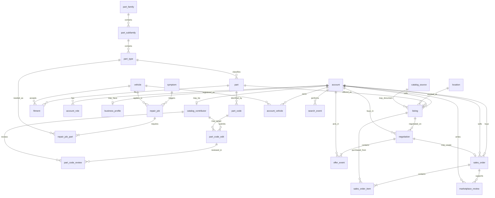

# 03 — Modelo de datos

Última actualización: 2026-10-13
Estado: v15 — geografía DANE en §27 (D121–D128, hito DANE/DIVIPOLA, 2026-10-13): `marts.dim_municipality`, mapa `marts.map_runt_municipality_dane` y `marts.fct_vehicle_fleet_snapshot_dane`; el municipio sigue siendo el de matrícula (D97) y el fct de D100 no cambia; §17 y pregunta 2 de §I marcadas como resueltas. Versión anterior: v14 — linaje de `vehicle_fleet_snapshot` (raw → normalized → `landing.vehicle_fleet_snapshot` → `staging.stg_vehicle_fleet_snapshot` → `marts.fct_vehicle_fleet_snapshot`) en §3 y nota de implementación en §27 (D96–D103, Fase 1b, 2026-10-12); el municipio es el de matrícula; D51 y D59 sin cambio. Versión anterior: v13 — linaje dbt de `landing.fx_rate` → `staging.stg_fx_rate` → `marts.fct_fx_rate_daily` en §3 y §26 (D85–D88, hito dbt, 2026-10-11); mismas 7 columnas en cada capa, sin derivadas; sin cambio de entidades ni de grano. Antes: v12 — notas de linaje de `landing.fx_rate` en §3 y de la tabla en §26 (D79–D82, hito loader fx_rate, 2026-10-11); sin cambio de entidades ni de grano. Antes: v11 — nota de implementación de `fx_rate` para la TRM (D77, D76): par USD→COP, `rate` = COP por 1 USD, `source_reference`, columnas del CSV normalizado; sin cambio de grano (D47). Antes: v10 — aclaración de §1 sobre modelo fuente/analítico frente a OLTP (D70, D72). Sin cambios de entidades. Antes: v9 — alineado con `02_domain_taxonomy.md` v12; nota de mapeo del manifest en §3 (paso 3 de Fase 1, D65 y D66).

## 1. Propósito

Este documento define el **modelo de entidades fuente** que producirían el marketplace, el generador sintético y las fuentes externas.

Los modelos analíticos de dbt (`stg_*`, `int_*`, `dim_*`, `fct_*`, marts) se diseñarán en la Fase 3 a partir de estas entidades.

Objetivos del modelo:

- representar el negocio sin duplicar identidades;
- preservar eventos e historial relevantes;
- permitir ingestas idempotentes;
- facilitar lineage y replay;
- generar hechos suficientes para analítica de demanda, oferta, negociación, transacciones y reputación.

Alcance de este documento (D70, D72): describe el **modelo fuente y analítico** del dominio (entidades de marketplace, taller y fuentes externas) que alimenta el warehouse. **No es el schema OLTP de las apps.** Cada app tendrá su propio modelo transaccional, con persistencia y autorización propias, separado del warehouse por base y rol; el de este documento es el contrato de referencia de dominio y de los eventos que esas apps publican por outbox. Por eso el `tenant_id` del taller (D72) y las entidades de servicio de D69 se diseñarán en su hito, no aquí. Las columnas de metadata de ingesta de la §3 y las entidades de este documento no implican que las apps las usen en su modelo transaccional.

## 2. Convenciones

- Tablas y columnas: inglés, `snake_case`.
- Taxonomías controladas: llave natural `*_code`.
- Entidades operativas: llave sustituta `*_id`.
- Timestamps en UTC en almacenamiento; conversión de zona horaria en consumo.
- Monedas con código ISO 4217 cuando aplique.
- Países con ISO 3166-1 alpha-2 cuando aplique.
- Los valores derivados no se almacenan si pueden recalcularse con seguridad.
- Excepción: snapshots necesarios para preservar el contexto histórico al momento de un evento.
- Eventos de negocio que necesiten auditoría se prefieren append-only.

## 3. Contrato técnico de ingesta

Cuando una entidad proviene de una fuente externa o de un batch generado, la plataforma debe poder reconstruir su procedencia mediante metadata técnica.

Campos o metadata de control esperados:

| Campo | Propósito |
|---|---|
| `source_system` | Sistema/API/generador de origen |
| `source_record_id` | Identificador original cuando exista |
| `ingestion_batch_id` | Batch que introdujo el registro |
| `ingested_at` | Momento de llegada a la plataforma |
| `raw_object_path` | Ubicación del payload raw en el storage S3 (SeaweedFS, D57) |
| `record_hash` | Opcional; detección de cambios/duplicados |

No es obligatorio duplicar estas columnas en todas las tablas de negocio. La implementación puede combinar columnas técnicas y tablas de control.

### Mapeo del manifest v1 a estos campos (paso 3, D65 y D66)

Nota de implementación; el modelo no cambia. El manifest (`manifest.json`, `04_infra.md` §8.1) es la fuente de la metadata técnica del raw:

| Campo de esta sección | Origen en el manifest v1 | Nota |
|---|---|---|
| `source_system` | `source_system` | Para la TRM: `superfinanciera_trm` (D61). |
| `source_record_id` | no aplica en el raw | La TRM no trae ID de registro. La llave natural es `vigenciadesde`; el dedupe lógico se hace en el parser (paso 5). |
| `ingestion_batch_id` | `batch_id` | uuid4 de la corrida. |
| `ingested_at` | `finished_at` | Momento de cierre del batch, en UTC. |
| `raw_object_path` | `s3://pits-raw/<files[].key>` | Una ruta por payload. Una fila pertenece al archivo cuyo rango `offset` a `offset + row_count` la contiene. |
| `record_hash` | `files[].sha256` | Hash por archivo (payload completo), no por fila. El hash por fila, si se necesita, lo calcula el parser. |

Los campos `watermark` (`mode`, `from_exclusive`, `to_observed`) y `source_rows_updated_at` del manifest no son columnas de negocio: sirven a la ingesta incremental (D66).

### Linaje de `landing.fx_rate` (D81, hito loader fx_rate, 2026-10-11)

Nota de implementación; el modelo no cambia y no hay columnas derivadas. `landing.fx_rate` guarda `source_reference` y `load_id`; el resto de la metadata se obtiene por unión, sin columnas nuevas:

| Campo de esta sección | Origen en la carga | Nota |
|---|---|---|
| `source_system` | `landing.fx_rate.source_system` | Constante del loader para la TRM: `superfinanciera_trm`. |
| `source_record_id` | no aplica | La TRM no trae ID de registro; la llave natural es fecha + par. |
| `ingestion_batch_id` | `source_reference`: uuid de `batch_id=` dentro de la key raw | No es columna. |
| `raw_object_path` | `source_reference`: parte antes de `#row=` | Key del payload raw; la ruta completa es `s3://pits-raw/<key>`. No es columna. |
| `ingested_at` | `load_id` → `ops.load_run.normalized_manifest` → `inputs[]`: `finished_at` del input con el mismo `batch_id` | No es columna. |
| `fingerprint` | `load_id` → `ops.load_run.input_fingerprint` | No es columna. |
| `loaded_at` | `load_id` → `ops.load_run.loaded_at` | No es columna. |

`ops.load_run.normalized_manifest` guarda el contenido parseado del manifest normalizado, no sus bytes; los bytes exactos los acredita `manifest_sha256` junto con `manifest_key`.

### Linaje dbt de `fx_rate` (D85–D88, hito dbt, 2026-10-11)

Nota de implementación; el modelo no cambia y no hay columnas nuevas ni derivadas. Cada capa conserva las mismas 7 columnas (`rate_date`, `currency_from`, `currency_to`, `rate`, `source_system`, `source_reference`, `load_id`):

| Capa | Objeto | Materialización (dbt, D87) | Origen |
|---|---|---|---|
| `landing` | `landing.fx_rate` | tabla (la crea `pits db migrate`, D81) | `pits load fx-rate` (D82) |
| `staging` | `staging.stg_fx_rate` | view | `select` 1:1 sobre `landing.fx_rate` |
| `marts` | `marts.fct_fx_rate_daily` | table | `select` sobre `stg_fx_rate` |

`ops.load_run` no es una capa de datos del modelo: dbt la usa como fuente de freshness (`loaded_at`, filtro `dataset = 'fx_rate'`) y como destino de la prueba `relationships` de `load_id`. La metadata de este documento sigue saliendo de la unión con `ops.load_run`, como antes. El reader ve solo `marts` (D86).

### Linaje de `vehicle_fleet_snapshot` (D96–D103, Fase 1b, 2026-10-12)

Nota de implementación; la entidad de §27 no cambia de nombre ni de fuente (D51, D48). El municipio es el de matrícula (respuesta de Henry, 2026-10-12, D97). Linaje por capa:

| Capa | Objeto | Origen | Decisión |
|---|---|---|---|
| raw | `pits-raw`, `source_system=mintransporte_runt_parque`, uno o más batches por publicación (`u3vn-bdcy`); gana el último committed (hoy hay 3 de 2026-10) | `pits extract runt` (SODA, `$order=:id ASC`, `$limit=5000`) | D96 |
| normalized | `vehicle_fleet_snapshot/source_system=…/publication_month=YYYY-MM/fingerprint=…/part-NNNNN.csv` + `manifest.json` | `pits normalize runt` | D98, D103 |
| landing | `landing.vehicle_fleet_snapshot` (migración `0004_landing_vehicle_fleet_snapshot.sql`) | `pits load vehicle-fleet` | D99 |
| staging | `staging.stg_vehicle_fleet_snapshot` (view; `transform/models/staging/`) | `select` 1:1 sobre `landing.vehicle_fleet_snapshot`, más `department_name_norm`, `municipality_name_norm` y `vehicle_class_norm` | D100 |
| marts | `marts.fct_vehicle_fleet_snapshot` (table; `transform/models/marts/`) | `select` sobre staging, con las versiones originales y `_norm`; sin filtro `ACTIVO` y sin DANE | D100 |

Grano y PK de `landing.vehicle_fleet_snapshot` (D97, verificado en la migración 0004): `publication_year`, `publication_month`, `department_name`, `municipality_name`, `service_name`, `vehicle_status`, `vehicle_class` y `registration_year` (`fecha_de_registro`). La medida es `vehicle_count` (`cantidad`), con `vehicle_count > 0`. Además `source_system`, `source_reference` y `load_id` (FK a `ops.load_run`). Un año de registro entre 1900 y el año de publicación; se conservan 1900 y 1901 como centinela.

Reglas de publicación: gana el último batch committed por publicación; una publicación nunca borra otra; no se inventa una fecha de corte; un mes faltante no es error. Se conservan todos los estados, servicios y clases. `INCONSISTENTE` se conserva en landing y marts, y la demanda filtra `ACTIVO` (D59). Abierto: la regla de publicación del RUNT y el significado de `INCONSISTENTE` no los conoce Henry (`06_status.md` §7).

Dependencia del mart: `fct_vehicle_fleet_snapshot` declara `-- depends_on: source('ops','load_run_fleet')` para que el test de dos padres bloquee el mart (D100; lección 118). Las pruebas de `_norm` (charset) y de conciliación `EXCEPT ALL` con staging están en `transform/tests/`.

## 4. Diagrama entidad-relación conceptual



`fx_rate` y `vehicle_fleet_snapshot` no necesitan una relación FK directa con todas las entidades; se integran en dbt según fecha, moneda, clase de vehículo o geografía. La marca y el modelo del parque no vienen del RUNT real: salen del desglose sintético (D48, §27). Ese desglose aplica solo al segmento PARTICULAR (D52, D55); el servicio PÚBLICO es un segmento de flotas aparte (D54); OFICIAL queda fuera de la demanda y OTROS y NO REGISTRA fuera del MVP (D56).

---

# A. Identidad y participantes

## 5. `account`

Grano: **una identidad participante de la plataforma**.

| Campo | Tipo lógico | Notas |
|---|---|---|
| `account_id` | bigint | PK |
| `account_type` | text | `individual`, `business` |
| `display_name` | text | Nombre visible |
| `country_code` | text | ISO alpha-2 |
| `created_at` | timestamp | UTC |
| `status` | text | Por definir al implementar |

Una cuenta puede comprar, vender y/o contribuir datos técnicos.

## 6. `account_role`

Grano: **un rol activo por cuenta**.

PK lógica: (`account_id`, `role_code`).

| Campo | Notas |
|---|---|
| `account_id` | FK a `account` |
| `role_code` | `buyer`, `seller`, `catalog_contributor` |
| `role_type` | Nullable. Para `buyer`, un valor de `buyer_type`; para `seller`, un valor de `seller_type`; nulo para `catalog_contributor` (su tipo vive en `catalog_contributor.contributor_type`) |
| `granted_at` | UTC |

Por qué `role_type` va aquí y no en `business_profile`: las cuentas individuales no tienen
perfil comercial, pero sí necesitan clasificación (`driver`, `independent_mechanic`,
`individual`).

Esto reemplaza el diseño anterior con tablas separadas de `buyer` y `seller` como identidades independientes.

## 7. `business_profile`

Grano: **perfil comercial de una cuenta de negocio**.

| Campo | Notas |
|---|---|
| `account_id` | PK/FK a `account` |
| `legal_name` | Opcional en sintético |
| `city` / `location_id` | Según decisión de geografía |

Una cuenta individual no necesita `business_profile`.

## 8. `account_vehicle`

Grano: **un vehículo registrado por una cuenta**.

PK lógica: (`account_id`, `vehicle_id`).

Campos:

- `registered_at`
- alias opcional futuro

---

# B. Catálogo técnico

## 9. Catálogo de partes

| Tabla | Grano | Llave | Columnas principales |
|---|---|---|---|
| `part_family` | familia | `part_family_code` | `name` |
| `part_subfamily` | subfamilia | `part_subfamily_code` | `part_family_code`, `name`, `vehicle_scope` |
| `part_type` | clase de pieza | `part_type_code` | `part_subfamily_code`, `name` |
| `part` | pieza concreta | `part_id` | `part_type_code`, `part_brand`, `name`, `description` |
| `part_code` | código activo/histórico de una pieza | `part_code_id` | `part_id`, `code_type`, `code_value`, `brand`, `valid_from`, `valid_to`, `source_reference` |

Regla inicial de unicidad de `part_code`:

```text
(code_type, brand, code_value)
```

Esta regla debe probarse contra datos reales antes de asumir que no existen excepciones.

`confidence_score` no se almacena en origen; se deriva en dbt.

## 10. Vehículos

### `vehicle`

Grano: **configuración de vehículo representada por combinación de modelo/versión/rango**.

Campos principales:

- `vehicle_id`
- `vehicle_type`
- `make`
- `model`
- `year_from`
- `year_to`
- `engine_displacement_cc`
- `fuel_type`
- `trim`
- `manufacture_country`

La representación por rango de años es una simplificación del MVP.

### `fitment`

Grano: **compatibilidad entre una pieza y una configuración de vehículo**.

PK lógica:

```text
(part_id, vehicle_id)
```

Campos:

- `source_reference`
- `notes`
- metadata técnica de procedencia cuando aplique

El fitment sintético debe marcarse inequívocamente como sintético.

---

# C. Contribución y moderación del catálogo

## 11. `catalog_contributor`

Grano: **perfil de una cuenta habilitada para contribuir datos técnicos**.

| Campo | Notas |
|---|---|
| `contributor_id` | PK |
| `account_id` | FK a `account`, único |
| `contributor_type` | `manufacturer_rep`, `distributor`, `seller`, `community` |
| `business_profile_verified` | input de confianza |
| `gbp_rating` | input, nullable |
| `gbp_review_count` | input |
| `is_certified` | input |
| `initial_test_score` | 0–100 |
| `created_at` | UTC |

No guarda `contributor_trust_score`; se calcula en dbt.

## 12. `part_code_edit`

Grano: **una propuesta append-only para crear, actualizar o eliminar un código de parte**.

| Campo | Notas |
|---|---|
| `part_code_edit_id` | PK |
| `part_code_id` | Nullable; no existe todavía en una creación pendiente |
| `contributor_id` | Autor |
| `action` | `create`, `update`, `delete` |
| `previous_snapshot` | JSONB nullable |
| `change_payload` | JSONB con valores propuestos |
| `contributor_trust_score_at_submit` | Snapshot histórico |
| `is_senior_at_submit` | Snapshot histórico |
| `submitted_at` | UTC |

### Por qué se usa payload

El diseño anterior tenía solo `old_value` y `new_value`, pero un código posee varios atributos. Un payload permite representar una creación completa o un cambio multicolumna sin perder el carácter append-only.

El schema del payload debe validarse según `action` mediante tests o validación de aplicación/generador.

## 13. `part_code_review`

Grano: **una decisión de revisión sobre una propuesta**.

| Campo | Notas |
|---|---|
| `part_code_review_id` | PK |
| `part_code_edit_id` | FK |
| `reviewer_contributor_id` | FK |
| `decision` | `approved`, `rejected` |
| `reviewed_at` | UTC |
| `notes` | Opcional |

Estado analítico de la edición:

1. Si hay revisiones, manda la revisión más reciente.
2. Si no hay revisión y `is_senior_at_submit = true`, queda `certified`.
3. En otro caso queda `suggested`.

La revisión posterior puede corregir una certificación automática.

---

# D. Conocimiento técnico

## 14. `symptom`

Grano: **síntoma o problema técnico genérico**.

Llave: `symptom_code`.

Campos:

- `name`
- `vehicle_scope`

## 15. `repair_job`

Grano: **trabajo de reparación/mantenimiento aplicable a un vehículo o alcance**.

Campos:

- `repair_job_id`
- `job_category`
- `symptom_code`
- `vehicle_type`
- `vehicle_id`
- `interval_km`
- `interval_months`
- `interval_source`

Reglas:

- `corrective_repair` exige `symptom_code`;
- `preventive_maintenance` no lleva síntoma y exige al menos uno entre `interval_km` / `interval_months`;
- `preventive_maintenance` exige `interval_source` cuando el intervalo se presenta como real;
- `vehicle_id` nulo significa alcance amplio dentro de `vehicle_type`.

## 16. `repair_job_part`

Grano: **tipo de parte requerido por un repair job**.

PK lógica:

```text
(repair_job_id, part_type_code)
```

Campos:

- `is_required`
- `quantity`
- `quantity_unit`

Regla: `quantity > 0`.

Valores provisionales de `quantity_unit`: `piece`, `pair`, `set`, `liter`.

---

# E. Marketplace

## 17. `location`

Grano: **ubicación normalizada usada por inventario y cuentas**.

Diseño provisional:

- `location_id`
- `country_code`
- `department_name`
- `city_name`
- `official_code` nullable

La decisión de usar código DANE desde el MVP depende de la inspección de fuentes oficiales en Fase 0.5. RESUELTA por D121–D128 (hito DANE/DIVIPOLA): ver `marts.dim_municipality` en §27.

## 18. `catalog_source`

Grano: **fuente/catalogo técnico identificado**.

Campos:

- `catalog_source_id`
- `brand`
- `catalog_name`
- `url`
- `access_type`
- `scraping_allowed`
- `last_checked_at`

## 19. `listing`

Grano: **una publicación actual de una pieza por vendedor, condición y ubicación**.

Campos:

- `listing_id`
- `seller_account_id`
- `part_id`
- `condition`
- `location_id`
- `stock_qty`
- `price`
- `currency`
- `catalog_source_id` nullable
- `created_at`
- `updated_at`

Regla lógica de unicidad:

```text
(seller_account_id, part_id, condition, location_id)
```

Esto corrige el modelo anterior, que omitía ubicación aunque un vendedor pudiera tener inventario en varias ciudades.

`in_stock` se deriva como `stock_qty > 0`.

### Historial futuro

El MVP puede mantener el estado actual de `listing`. En una fase posterior se agregará historial mediante snapshots o SCD2 para analizar precio e inventario en el tiempo.

## 20. `search_event`

Grano: **una búsqueda realizada en el marketplace**.

Campos:

- `search_event_id`
- `occurred_at`
- `session_id`
- `account_id` nullable para anónimo
- `query_text`
- `make`
- `model`
- `year`
- `secondary_filters` JSONB
- `results_count`

Los filtros primarios quedan como columnas porque se consultarán frecuentemente.

Las búsquedas con `results_count = 0` alimentan el mart de demanda insatisfecha.

## 21. `negotiation`

Grano: **una negociación entre un comprador y un vendedor alrededor de una publicación**.

Campos:

- `negotiation_id`
- `listing_id`
- `buyer_account_id`
- `opened_at`
- `closed_at` nullable

El vendedor se obtiene del `listing`; no se duplica salvo que se necesite snapshot histórico explícito.

## 22. `offer_event`

Grano: **un evento append-only dentro de una negociación**.

Campos:

- `offer_event_id`
- `negotiation_id`
- `actor_account_id`
- `event_type`
- `amount` nullable
- `currency` nullable
- `quantity` nullable
- `created_at`
- `related_offer_event_id` nullable

`event_type`:

- `offer_created`
- `counteroffer_created`
- `accepted`
- `rejected`
- `withdrawn`
- `expired`

Reglas:

- eventos de propuesta (`offer_created`, `counteroffer_created`) requieren `amount`, `currency` y `quantity`;
- eventos de resolución pueden apuntar mediante `related_offer_event_id` a la propuesta afectada;
- el estado actual de una negociación se deriva de sus eventos.

Este diseño permite estudiar event modeling, ventanas temporales y reconstrucción de estado.

## 23. `sales_order`

Grano: **una orden creada por un comprador**.

Campos:

- `sales_order_id`
- `buyer_account_id`
- `seller_account_id`
- `negotiation_id` nullable
- `created_at`
- `status`
- `currency`

Regla de grano: una orden pertenece a un comprador y un vendedor. Si una experiencia futura permite un carrito con múltiples vendedores, el checkout crea una orden por vendedor.

Todos los `sales_order_item` de una orden deben apuntar a listings del mismo `seller_account_id`.

Estados iniciales:

- `created`
- `confirmed`
- `completed`
- `cancelled`
- `returned`

## 24. `sales_order_item`

Grano: **una línea de orden**.

Campos:

- `sales_order_item_id`
- `sales_order_id`
- `listing_id`
- `quantity`
- `unit_price`
- `returned_at` nullable
- `return_reason` nullable

`unit_price` conserva el precio pactado aunque el listing cambie después.

## 25. `marketplace_review`

Grano: **una reseña de una cuenta a otra vinculada a una orden**.

Campos:

- `marketplace_review_id`
- `sales_order_id`
- `reviewer_account_id`
- `reviewed_account_id`
- `reviewed_role` (`buyer`, `seller`)
- `rating` 1–5
- `comment` nullable
- `created_at`

Restricción lógica recomendada:

```text
unique(sales_order_id, reviewer_account_id, reviewed_account_id)
```

La reputación comercial se calcula en dbt; no se guarda como score fuente.

---

# F. Fuentes externas

## 26. `fx_rate`

Grano:

```text
rate_date + currency_from + currency_to
```

Campos:

- `rate`
- `source_reference`

Nota (D47, D46): la fuente es la TRM de la Superfinanciera, dataset `32sa-8pi3`, que llega por rango (`vigenciadesde`-`vigenciahasta`). El normalizer expande cada rango a una fila por día calendario (fines de semana y festivos heredan la TRM vigente); el grano sigue siendo fecha única. Raw y manifest conservan el rango original.

Implementación del normalizer TRM (D77, D76, hito TRM normalize, 2026-10-11):

- Par: `currency_from = USD`, `currency_to = COP`. `rate` = COP por 1 USD (`valor` sin transformar). Exige `unidad == "COP"`; si no, error permanente. No se guarda la inversa. La regla aplica solo al normalizer de la TRM `32sa-8pi3`; no restringe la entidad genérica `fx_rate` para otras fuentes, que definen su par y orientación con su propia D.
- Grano sin cambios (D47): `rate_date + currency_from + currency_to`.
- Columnas del CSV normalizado (`fx_rate.csv`): `rate_date,currency_from,currency_to,rate,source_reference`. `rate_date` ISO; `rate` Decimal de punto fijo, sin exponente ni ceros finales y sin redondeo; una fila por `rate_date` ascendente.
- `source_reference` = `<key del payload raw>#row=<i>`, con `i` desde 0 dentro de la página del payload. Permite rastrear cada tasa hasta su fila de origen en raw.
- Decisiones de implementación (paso S4, documentadas aquí según el plan aprobado): `row_count` del manifest raw del batch = registros leídos de sus páginas; orden estricto entre páginas; una fila fuera del watermark del batch es error; el valor debe cumplir el formato ASCII `[0-9]+(\.[0-9]+)?`; un `since` vacío que borra la cola sin reponerla falla con `CoverageError` (D76(c)).

Implementación en Postgres (`landing.fx_rate`, D79–D82; hito loader fx_rate, 2026-10-11):

- Tabla `landing.fx_rate` en la base `pits_warehouse`, con el grano de esta sección como PK (`fx_rate_pk`). Columnas: `rate_date`, `currency_from`, `currency_to`, `rate` (numeric sin precisión fija), `source_system`, `source_reference`, `load_id` (FK a `ops.load_run`).
- CHECK: moneda en `^[A-Z]{3}$`, par con monedas distintas, `rate > 0` sin NaN ni Infinity, y `source_system` y `source_reference` no vacíos. Detalle en `05` D81.
- Carga desde `fx_rate.csv` con `pits load fx-rate` (D82): la tabla queda igual al artefacto mediante `MERGE`; las filas de la TRM que ya no están en el artefacto se borran.
- Linaje: ver §3 (sin columnas derivadas).
- Capas de dbt (hito dbt, D85–D88, 2026-10-11): `staging.stg_fx_rate` (view, 1:1 sobre `landing.fx_rate`, 7 columnas) y `marts.fct_fx_rate_daily` (table, 7 columnas). Los schemas `staging`, `intermediate` y `marts` los crea el bootstrap con dueño `pits_owner` (D86), no dbt; `intermediate` queda vacío. Sin columnas derivadas, sin inversa y sin conversiones (fuera de este hito). Pruebas y freshness: D87. Lectura: el reader solo ve `marts` (D86).

## 27. `vehicle_fleet_snapshot`

Antes `vehicle_registration_stat` (renombrada por D51).

Entidad de parque (STOCK, no flujo; regla 5). Grano: un corte mensual (`a_o_de_publicacion` + `mes_de_publicacion`) por combinación de las columnas de dimensión del dataset RUNT `u3vn-bdcy` (`08_market_research.md`, Ficha 1); `cantidad` es la medida. La unicidad de esa combinación no está verificada (`08`, No encontrado: `count(*)` 191.293 vs 191.640 filas sin explicar): se valida al implementar la Fase 1b. Columnas inspeccionadas:

- `nombre_departamento`, `nombre_municipio`, `nombre_servicio`, `estado_del_vehiculo` (`ACTIVO`, `INCONSISTENTE`), `nombre_de_la_clase` (text);
- `fecha_de_registro` (año; `1900` es valor centinela), `cantidad`, `a_o_de_publicacion` (number) y `mes_de_publicacion` (text, p. ej. `AGOSTO`).

Los nombres de columna son los de origen; el nombre final de las columnas en el modelo (`snake_case` en inglés, §2) y los tipos físicos se deciden al implementar la Fase 1b. `08` declara los tipos de Socrata, pero el JSON los devuelve todos como string (`08`, Ficha 1; re-verificado el 2026-10-10: `cantidad` llega como `"1"`); se castean en el parser. `08` no define una llave única de fila ni ofrece historial: la fuente trae un único corte (agosto 2026), por lo que cada snapshot mensual debe guardarse en raw (`08`, Objetivo 4).

**Geografía DANE (D121–D128, hito DANE/DIVIPOLA, 2026-10-13).** El municipio de matrícula de `vehicle_fleet_snapshot` se cruza con el código DANE de municipio sin cambiar la entidad ni el grano:

- `marts.dim_municipality` (table): una fila por código DANE de DIVIPOLA (`gdxc-w37w`, DANE, CC BY-SA 4.0), con `_norm` de nombres y lat/lon tipadas (D121, D125).
- `marts.map_runt_municipality_dane`: una fila por par RUNT normalizado (departamento y municipio). Primero aplica el seed versionado de excepciones `transform/seeds/runt_municipality_dane_exception.csv` y después el cruce exacto por `_norm`; no hay reglas difusas (D126). Un par sin código conserva su fila con código null (D128).
- `marts.fct_vehicle_fleet_snapshot_dane`: mismo grano y mismas filas que `fct_vehicle_fleet_snapshot`, con las columnas `dane_municipality_code`, `dane_department_code` y `dane_match_method` (D127). El fct de D100 no cambia.

Inferencia (D121): el municipio de matrícula es la sede del organismo de tránsito, no necesariamente donde circula el vehículo. Lat/lon no se usan para demanda.

Re-verificado 2026-10-10: el corte vigente en `u3vn-bdcy` es OCTUBRE 2026 y el corte agosto 2026 citado arriba ya no existe en la fuente. Inferencia: la fuente conserva solo el corte vigente y se sobrescribe cada mes.

**Segmentación por servicio.** `nombre_servicio` tiene 5 valores reales (RUNT `u3vn-bdcy`, corte OCTUBRE 2026; ver `research/parque_por_marca.md`, sección 3):

| Valor | Tratamiento |
|---|---|
| `PARTICULAR` | Segmento de demanda con desglose sintético de marca (D52, D55) |
| `PÚBLICO` (con tilde) | Segmento de flotas, comprador `fleet_operator`; dato real por clase/geografía, desglose de marca sin calibrar (D54) |
| `OFICIAL` | Fuera de la demanda; se conserva como dato real (D56) |
| `OTROS` | Fuera del MVP; se conserva como dato real (D56) |
| `NO REGISTRA` | Fuera del MVP; se conserva como dato real (D56) |

**Filtro de estado (D59).** La demanda y el desglose sintético usan solo `estado_del_vehiculo` = `ACTIVO`; `INCONSISTENTE` (41.349 vehículos, corte OCTUBRE 2026) se conserva en `vehicle_fleet_snapshot` pero no entra en la demanda.

El desglose sintético sigue el orden marca y luego línea (D53) y se calibra con Boyacá `em3d-hmim` y Risaralda `x9pp-pcn5`, con `AUTECO` reasignado a la marca real por línea (D52, D55). Hace falta un mapa de normalización entre fuentes: de clase (`CAMION` y `CAMIÓN` son la misma clase en RUNT; `MICRO BUS` en Boyacá frente a `MICROBUS` en RUNT; `TRACTO-CAMION` frente a `TRACTOCAMION`) y de servicio (`PÚBLICO` en RUNT frente a `PUBLICO` en Boyacá y Floridablanca; `OTRO` frente a `OTROS`). El filtro aplica a la `cantidad` RUNT que se desglosa; las proporciones de calibración siguen D55 (Risaralda no permite filtrar estado).

El RUNT no trae marca ni modelo (D48). El desglose del parque por marca/modelo se genera sintético (generador, Fase 2), calibrado con investigación pública con fuente verificable, y debe marcarse como sintético en su procedencia (§28). Esta entidad contiene solo el dato real del RUNT. Dónde vive el desglose sintético (entidad aparte o columna de origen, según §28) se decide en Fase 2. El desglose sintético no es dato real ni métrica oficial de demanda.

**Implementación Fase 1b (D96–D103, 2026-10-12).** La unidad de carga es la publicación (año y mes de `a_o_de_publicacion` y `mes_de_publicacion`), no un corte "vigente" único: cada publicación se acumula en landing y gana el último batch committed. El grano implementado es el de la PK de 8 columnas de §3 (publicación, departamento, municipio, servicio, estado, clase y `fecha_de_registro`), con `cantidad` como medida. La demanda (D59) sigue filtrando `ACTIVO`; el filtro no se aplica en landing ni en el mart, y el desglose sintético de §27 no se implementa en Fase 1b. La cifra de la fuente que se cita en esta sección sigue siendo la del corte OCTUBRE 2026 (`08_market_research.md`, Ficha 1, corregida el 2026-10-12).

---

# G. Origen esperado por entidad

| Entidades | Origen |
|---|---|
| `part_family`, `part_subfamily`, `part_type`, `symptom` | Seeds CSV versionados |
| `vehicle` | NHTSA vPIC + datos curados/específicos de Colombia según validación |
| `fx_rate` | TRM Superfinanciera `32sa-8pi3` (D46, D47) |
| `vehicle_fleet_snapshot` | RUNT `u3vn-bdcy` (real, por clase/geografía; D48) |
| Desglose del parque por marca/modelo (segmento PARTICULAR) | Generador sintético calibrado con Boyacá `em3d-hmim` + Risaralda `x9pp-pcn5` (D52, D55); procedencia sintética y regional; ubicación (entidad o columna de origen) por definir en Fase 2 |
| Segmento servicio público (flotas) | RUNT `u3vn-bdcy` real por clase/geografía; desglose de marca sin calibrar (D54) |
| `catalog_source` | Metadatos de fuentes permitidas |
| `part`, `part_code`, `fitment` | Sintético inicialmente; cualquier fuente real futura debe registrar procedencia |
| `account`, `account_role`, `business_profile`, `account_vehicle` | Generador sintético |
| `catalog_contributor`, `part_code_edit`, `part_code_review` | Generador sintético |
| `listing`, `search_event`, `negotiation`, `offer_event` | Generador sintético |
| `sales_order`, `sales_order_item`, `marketplace_review` | Generador sintético |

## 28. Regla de etiquetado sintético

Los datos sintéticos deben poder distinguirse sin ambigüedad de los datos reales mediante metadata de origen.

Nunca se mezclarán en una presentación como si fueran observaciones reales del mercado colombiano.

---

# H. Tests de datos previstos

## 29. Tests de esquema

- `not_null` en PKs y campos obligatorios.
- `unique` en llaves naturales declaradas.
- relaciones FK válidas.
- accepted values para enums.
- `accepted_values` de `nombre_servicio` en `vehicle_fleet_snapshot`: `PARTICULAR`, `PÚBLICO`, `OFICIAL`, `OTROS`, `NO REGISTRA` (valores reales del corte OCTUBRE 2026).

## 30. Tests de negocio

Ejemplos:

- `year_from <= year_to`.
- `stock_qty >= 0`.
- `price >= 0`.
- `rating between 1 and 5`.
- `quantity > 0`.
- `corrective_repair` requiere síntoma.
- `preventive_maintenance` requiere intervalo.
- evento de oferta requiere monto/moneda/cantidad.
- `accepted` debe referenciar una propuesta existente.
- `marketplace_review` debe involucrar cuentas relacionadas con la orden.
- listing seller debe tener rol `seller`.
- order buyer debe tener rol `buyer`.
- order seller debe tener rol `seller`.
- todos los listings de una orden deben pertenecer al `seller_account_id` de la orden.
- reviewer de `part_code_review` debe ser un contributor válido.
- `account_role.role_type` debe pertenecer a `buyer_type` cuando `role_code = buyer`, y a `seller_type` cuando `role_code = seller`.
- conservación del desglose sintético: la suma del desglose por (corte, clase, geografía, PARTICULAR) debe ser igual a la `cantidad` del RUNT para esa misma combinación y el filtro `estado_del_vehiculo` = `ACTIVO` (D59).

## 31. Tests de calidad/observabilidad

A definir por fuente:

- freshness;
- volumen esperado;
- duplicados por batch;
- cambios inesperados de schema;
- porcentaje de nulos;
- distribución anómala de métricas críticas.

---

# I. Preguntas abiertas

1. ¿Las unidades `piece`, `pair`, `set`, `liter` cubren los kits reales o se requieren más?
2. ¿Se normaliza geografía con código DANE desde el MVP? RESUELTA por D121–D128 (§27; texto original conservado).
3. ¿La reputación comercial será un único score o scores separados como comprador y vendedor? La decisión debe tomarse después de generar y analizar eventos fuente.
4. ¿En qué fase se incorpora historial de inventario/precio: inmediatamente en Fase 3 o como extensión SCD2?
